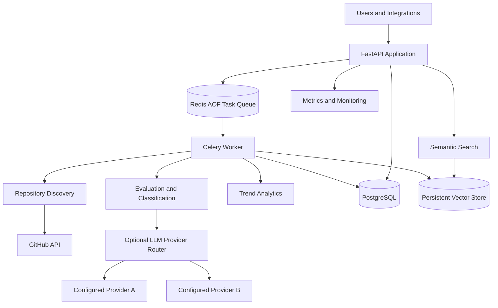

# Sovereign AI Arsenal

[](LICENSE)
[](https://www.python.org/)
[](#proof-of-concept--enterprise-customization-readiness)

**A modular intelligence platform for discovering, evaluating, and monitoring software repositories—with an optional provider-neutral LLM gateway.**

Sovereign AI Arsenal is designed as an extensible foundation: repository intelligence and analytics remain separate from model-provider integration, so model services can be changed without coupling the application to one vendor.

## Business problem

Teams evaluating large software ecosystems often rely on fragmented discovery tools, manual technical reviews, and provider-specific AI integrations. This makes it harder to compare projects consistently, track ecosystem changes, and control model-provider dependency.

## Solution

Sovereign AI Arsenal brings repository discovery, multi-dimensional evaluation, classification, trend analysis, semantic search, and API access into one modular platform. Its optional LLM Provider Router adds round-robin selection and quota-aware failover across independently configured OpenAI-compatible providers.

## Capabilities

- **Repository discovery:** GitHub-backed repository intake and filtering.
- **Technical and business evaluation:** configurable scoring and classification foundations.
- **Trend intelligence:** repository activity and growth analysis.
- **Semantic search:** vector-backed discovery capabilities.
- **API-first integration:** FastAPI endpoints and interactive API documentation.
- **Provider-neutral inference:** optional OpenAI-compatible chat gateway with cooldowns and failover.
- **Durable repository jobs:** Celery worker with Redis AOF persistence, bounded retries, task status, and PostgreSQL-backed repository records.
- **Scheduled repository inventory:** read-only GitHub Actions audit with bounded batch inspection and downloadable JSON reports; no Cloudflare deployment required.
- **Operational foundations:** Docker Compose, PostgreSQL, Redis, and monitoring components.
- **Repository sandbox module (not yet API-integrated):** gVisor-required execution policy with network disabled by default; see [Sandbox Security](docs/SANDBOX_SECURITY.md).

## Architecture



The provider router is optional and remains disabled until configured. Failover is between distinct providers; duplicate credentials must not be used to bypass a provider's published quotas. Repository discovery and analysis are queued to a dedicated Celery worker; see [Task Execution](docs/TASK_EXECUTION.md) for retry and persistence boundaries.

## Quick start

### Requirements

- Python 3.11+
- Docker Engine and Docker Compose (recommended)
- GitHub token for authenticated GitHub API access
- PostgreSQL and Redis when running outside the supplied Compose stack

An LLM API key is **not** required to start the core application. Configure provider credentials only if you intend to use LLM-backed analysis.

### Docker Compose

```bash
git clone https://github.com/zopair/Sovereign-AI-Arsenal.git
cd Sovereign-AI-Arsenal
cp .env.example .env
```

Edit `.env` and set unique values for the required database and API secrets. Keep the file private and never commit it.

```bash
docker compose up --build -d
```

Then open:

| Service | Local address |
|---|---|
| API health | http://127.0.0.1:8000/health |
| Interactive API docs | http://127.0.0.1:8000/docs |
| Prometheus | http://127.0.0.1:9090 |
| Grafana | http://127.0.0.1:3000 |

Protected API routes require the configured `X-API-Key` header. Keep services bound to localhost unless a separately reviewed deployment provides TLS, identity, and access controls.

### Local Python development

```bash
cd backend
python3.11 -m venv .venv
source .venv/bin/activate
pip install -r requirements.txt
cd ..
set -a
source .env
set +a
PYTHONPATH=. uvicorn backend.main:app --host 127.0.0.1 --port 8000 --reload
```

## Scheduled repository audit

A daily GitHub Actions workflow inspects the configured Zubair repositories and uploads a JSON inventory report. It uses a read-only GitHub token, pinned actions, and a bounded standard-library runner. Reports are retained as workflow artifacts for 14 days.

This provides a free scheduled alternative for batch repository inventory and documentation auditing when Cloudflare credentials or D1 deployment are unavailable. It is not an always-on worker API or a replacement for persistent D1 state; see [Repository Audit](docs/REPOSITORY_AUDIT.md).

## Background task execution

Repository discovery and analysis run through a dedicated Celery worker. The API returns a task ID immediately; poll GET /api/v1/tasks/{task_id} to inspect its state. The worker shares the existing Redis and PostgreSQL services and does not expose a public port.

See [Task Execution](docs/TASK_EXECUTION.md) for queue behavior, retry limits, persistence, and operational caveats.

## LLM Provider Router

The optional gateway exposes:

```text
POST /api/v1/llm/chat/completions
```

Configure independent OpenAI-compatible providers through `ZI_LLM_PROVIDERS`; store each credential in its named environment variable rather than embedding secrets in JSON or source control.

Example:

```bash
ZI_LLM_PROVIDERS='[
  {"name":"provider-a","base_url":"https://api.example-a.com/v1","model":"model-a","api_key_env":"PROVIDER_A_API_KEY"},
  {"name":"provider-b","base_url":"https://api.example-b.com/v1","model":"model-b","api_key_env":"PROVIDER_B_API_KEY"}
]'
```

See [LLM Provider Router documentation](docs/LLM_PROVIDER_ROUTER.md) for request examples, environment settings, retry behavior, and provider configuration guidance.

**Current boundaries:** non-streaming chat completions only; cooldown state is process-local; no built-in provider credentials or guaranteed free-tier access. Confirm each provider's current API terms, model availability, and quotas before enabling it.

## Development and validation

Install the backend test dependencies as documented by the repository, then run:

```bash
python -m compileall -q backend
pytest
```

Build the backend container:

```bash
docker compose build
```

The pull-request checks validate focused regressions and the backend container build. A green CI result is not a substitute for provider integration testing with credentials or a production deployment review.

## Proof of Concept & Enterprise Customization Readiness


| Area | Current status |
|---|---|
| Repository discovery and analysis | Celery/Redis worker with bounded exception retries; verify worker health and backups in deployment |
| API and containerization | Implemented; validate deployment configuration |
| LLM provider routing | Implemented for non-streaming chat; integration credentials required |
| Shared provider state across workers | Not implemented; cooldown state is process-local |
| Enterprise identity and authorization | Not implemented; current API key gate is not a tenant IAM system |
| Production operations and SLOs | Require environment-specific hardening and validation |

**Release posture:** Proof of Concept / MVP. The repository is suitable for technical evaluation and controlled demonstrations. Enterprise adoption requires a scoped customization, security, reliability, data-governance, and deployment review.

## Roadmap

- [ ] Add shared provider cooldown and health state when multi-worker deployment requires it.
- [ ] Expand provider contract tests and opt-in live integration checks.
- [ ] Define tenant-aware identity and authorization before exposing multi-user deployments.
- [ ] Validate observability, backup, recovery, and operational SLOs for each target environment.

## License

This project is distributed under the [MIT License](LICENSE). Review third-party component licenses and provider terms independently before redistributing or deploying an assembled solution.

## Intellectual Property & Authorship

Project authorship and attribution: **Aly Hussein Zopair (علي حسين زبير ALY HUSSEIN ZOPAIR)**.

This notice identifies the project author and does not override the repository license or the licenses and rights of third-party components.
