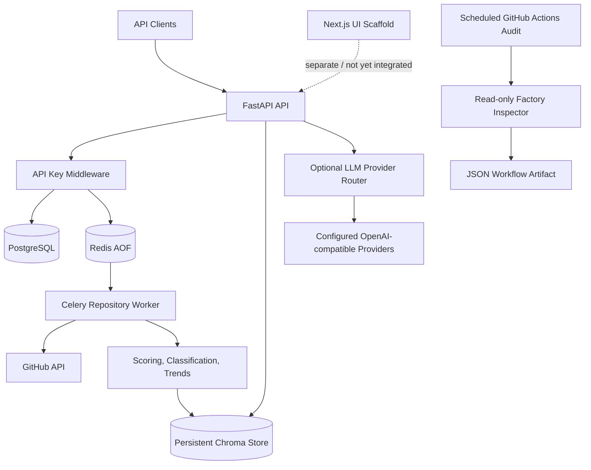

# Sovereign AI Arsenal

[](https://www.python.org/)
[](https://fastapi.tiangolo.com/)
[](https://nextjs.org/)
[](#proof-of-concept--enterprise-customization-readiness)

**A modular repository-intelligence platform for discovering, evaluating, classifying, and monitoring software repositories, with an optional provider-neutral LLM gateway.**

Sovereign AI Arsenal separates repository intelligence from model-provider integration. Its backend combines GitHub discovery, scoring and classification, trend analysis, semantic search, an authenticated API, and queued background jobs. A separate GitHub Actions factory provides bounded, read-only repository inventory reports.

> **Current maturity:** The Python API, worker, vector-store integration, provider router, and scheduled repository-audit workflow have implementation and CI evidence. The Next.js UI is currently a minimal scaffold, not a finished product dashboard. No hosted production demo is claimed.

## 1. Project Overview & Problem Statement

Engineering teams evaluating large software ecosystems often depend on fragmented discovery tools, manual technical reviews, and provider-specific AI integrations. This makes repository comparison, ecosystem monitoring, and model-provider portability difficult.

Sovereign AI Arsenal provides a modular foundation for:

- Discovering repositories through the GitHub API.
- Evaluating and scoring repository metadata and activity.
- Classifying repositories and tracking trends.
- Searching indexed repository content with keyword or vector-based methods.
- Exposing repository operations through a FastAPI interface.
- Processing discovery and analysis requests through a Celery worker.
- Routing optional OpenAI-compatible chat requests across configured providers.
- Producing scheduled, read-only JSON inventory reports using GitHub Actions.

### Architecture



The gVisor sandbox module is a separate, currently non-integrated capability. It is not invoked by the default API or Celery task flow.

## 2. Tech Stack & Versions

| Layer | Repository-backed technology |
|---|---|
| Backend runtime | Python 3.11 |
| API | FastAPI 0.104.1, Uvicorn 0.24.0, Pydantic 2.5.0 |
| Data access | SQLAlchemy 2.0.23, Alembic 1.13.1, psycopg2-binary 2.9.9 |
| Background jobs | Celery 5.3.4 |
| Queue / broker | Redis 7 (AOF enabled in the primary Compose stack) |
| Vector search | ChromaDB 0.4.18, sentence-transformers 2.2.2 |
| AI / data | Transformers 4.39.3, NumPy 1.24.4, pandas 2.1.4, scikit-learn 1.3.2 |
| Frontend scaffold | Next.js 16.1.1, React 19, TypeScript 5, Tailwind CSS 4 |
| JavaScript package manager | Bun lockfile; Bun types 1.3.4 in development dependencies |
| Local infrastructure | Docker Compose, PostgreSQL 15, Redis 7, Nginx, Prometheus, Grafana |

The frontend package versions are declared as semver ranges in `package.json`; the Python backend dependencies are pinned in `backend/requirements.txt`. The repository also contains a separate Prisma SQLite schema, but it is not wired into the primary PostgreSQL-backed API/Compose runtime.

## 3. Prerequisites & Dependencies

### Required for the recommended local stack

- Git
- Docker Engine and Docker Compose plugin
- OpenSSL (to generate local secrets)
- A machine with enough memory and disk for the Python dependencies and embedding model

### Optional

- Python 3.11 for running the backend outside Docker.
- Bun for frontend lint/build commands.
- A GitHub token for authenticated GitHub API access and higher rate limits.
- Provider credentials only if you choose to enable remote LLM inference.

The core repository API and scheduled inventory workflow do not require a paid AI API. Optional inference providers are external services and may have usage charges or limits; this project does not promise free provider access.

## 4. Installation & Local Setup

### Recommended: Docker Compose

Clone the repository and create a private environment file:

```bash
git clone https://github.com/zopair/Sovereign-AI-Arsenal.git
cd Sovereign-AI-Arsenal
cp .env.example .env
```

Generate four distinct values:

```bash
openssl rand -hex 32
openssl rand -hex 32
openssl rand -hex 32
openssl rand -hex 32
```

Set the generated values in `.env`:

- `POSTGRES_ADMIN_PASSWORD`
- `DB_PASSWORD`
- `GRAFANA_ADMIN_PASSWORD`
- `API_AUTH_TOKEN`

Validate the Compose configuration, then build and start the stack:

```bash
docker compose config --quiet
docker compose up --build -d
docker compose ps
```

The primary `docker-compose.yml` defines PostgreSQL, Redis, the FastAPI backend, a dedicated Celery worker, Nginx, Prometheus, and Grafana. Persistent named volumes are configured for database, queue, vector/model data, logs, and monitoring data.

### Local Python backend

From the repository root:

```bash
python3.11 -m venv .venv
source .venv/bin/activate
python -m pip install -r backend/requirements.txt
python -m pip install pytest pytest-asyncio
cp .env.example .env
```

Populate the required secrets and ensure PostgreSQL and Redis are available. Then run:

```bash
set -a
source .env
set +a
PYTHONPATH=. uvicorn backend.main:app --host 127.0.0.1 --port 8000 --reload
```

Run the worker in a separate terminal from the repository root:

```bash
REDIS_URL=redis://localhost:6379/0 PYTHONPATH=. celery \
  -A backend.core.celery_app:celery_app worker \
  --loglevel=INFO --concurrency=1 --queues=repository
```

### Frontend scaffold

The root `package.json` uses Bun and provides `dev`, `build`, `start`, and `lint` scripts:

```bash
bun install --frozen-lockfile
bun run dev
```

The current `src/app/page.tsx` only renders the project logo, and `src/app/api/route.ts` is a placeholder response. The frontend is not yet a functional interface to the Python API.

## 5. Environment Variables

The canonical starter file is [`.env.example`](.env.example). Keep the populated `.env` file out of version control.

| Variable | Required? | Purpose |
|---|---|---|
| `POSTGRES_ADMIN_PASSWORD` | Yes for Compose | PostgreSQL administrative password |
| `DB_PASSWORD` | Yes for Compose | Application database password |
| `GRAFANA_ADMIN_PASSWORD` | Yes for Compose | Grafana administrator password |
| `API_AUTH_TOKEN` | Yes for protected API | API key expected in the `X-API-Key` header |
| `GITHUB_TOKEN` | Optional | Authenticated GitHub API access |
| `OPENAI_API_KEY` | Optional | Legacy/optional OpenAI integration setting |
| `ZI_LLM_PROVIDERS` | Optional | JSON array defining independent OpenAI-compatible providers |
| `GROQ_API_KEY`, `GEMINI_API_KEY`, `OPENROUTER_API_KEY`, `MISTRAL_API_KEY`, `NVIDIA_API_KEY`, `ZAI_API_KEY` | Optional | Provider credentials referenced by provider configuration |
| `CLOUDFLARE_API_TOKEN`, `CLOUDFLARE_ACCOUNT_ID` | Optional / not required by primary stack | Retained integration settings; not required for the scheduled GitHub Actions audit |
| `API_BIND_ADDRESS`, `API_PORT`, `POSTGRES_PORT`, `GRAFANA_PORT`, `PROMETHEUS_PORT` | Optional | Local Compose bind addresses and ports |
| `CORS_ORIGINS` | Optional | Comma-separated allowed browser origins |

The LLM router reads provider definitions from `ZI_LLM_PROVIDERS`. Each definition names a provider, HTTPS base URL, model, and the environment variable containing its credential. Do not place credentials directly in the JSON value or source code. Provider cooldown state is process-local; it is not shared across multiple API workers.

The API leaves `/health` available for health probes. Routes under `/api/` and `/metrics` require `X-API-Key`; if `API_AUTH_TOKEN` is missing, protected routes return a configuration error rather than operating without authentication.

## 6. Usage Guide & Core Features

After the Compose stack is healthy:

| Service | Local URL |
|---|---|
| API root | http://127.0.0.1:8000/ |
| Health check | http://127.0.0.1:8000/health |
| Interactive API docs | http://127.0.0.1:8000/docs |
| ReDoc | http://127.0.0.1:8000/redoc |
| Prometheus | http://127.0.0.1:9090 |
| Grafana | http://127.0.0.1:3000 |

For protected API requests, provide the configured key:

```bash
curl -H "X-API-Key: $API_AUTH_TOKEN" \
  http://127.0.0.1:8000/api/v1/repositories
```

Core API operations include:

- `GET /api/v1/repositories` — list, sort, and filter stored repositories.
- `GET /api/v1/repositories/{repo_id}` — retrieve repository details, classifications, and trend history.
- `POST /api/v1/discover` — queue repository discovery.
- `POST /api/v1/repositories/{repo_id}/analyze` — queue an analysis job.
- `GET /api/v1/tasks/{task_id}` — inspect the status of a queued job.
- `GET /api/v1/search?q=...` — keyword, semantic, or hybrid repository search.
- `POST /api/v1/llm/chat/completions` — optional non-streaming OpenAI-compatible chat completion.
- `GET /api/v1/llm/providers/status` — inspect configured provider availability.

### Background job boundaries

The API publishes JSON-only tasks to Redis; the Celery worker performs repository discovery and analysis and persists results to PostgreSQL and Chroma. The configured worker uses concurrency 1, bounded retries, and a 24-hour task-result retention window.

This queue is not an arbitrary-code execution service. Celery/Redis does not guarantee exactly-once execution, and the gVisor sandbox module is not called by these tasks.

### Scheduled repository inventory

The `repository-audit.yml` workflow runs daily at 03:30 UTC, on relevant pushes, or manually. It inspects only the bounded target list in `factory/repository_targets.json`, uses the workflow's read-only GitHub token, and uploads a JSON artifact retained for 14 days. It does not modify the inspected repositories or execute their code.

See [Factory README](factory/README.md), [Repository Audit](docs/REPOSITORY_AUDIT.md), [Task Execution](docs/TASK_EXECUTION.md), [LLM Provider Router](docs/LLM_PROVIDER_ROUTER.md), and [Sandbox Security](docs/SANDBOX_SECURITY.md) for detailed behavior and limitations.

## 7. Live Demo & Screenshots

**No public hosted application URL or production deployment was verified during this repository review.** The supported demonstration path is the local Docker Compose stack and its interactive API documentation at `http://127.0.0.1:8000/docs`.

No product screenshots are currently referenced here. The Next.js page is a logo-only scaffold and should not be presented as a completed dashboard.

## 8. Testing & Verification

### Backend regression tests

```bash
python -m compileall -q backend
python -m pytest -q \
  backend/tests/test_api_module_regressions.py \
  backend/tests/test_security_and_background_tasks.py \
  backend/tests/test_vector_store_compatibility.py \
  backend/tests/test_provider_router.py \
  backend/tests/test_sandbox_policy.py \
  backend/tests/test_celery_queue.py
```

### Factory unit tests (Python standard library only)

```bash
python -m unittest discover -s factory -p "test_*.py" -v
```

### Compose validation and backend build

```bash
docker compose config --quiet
docker compose build backend
```

### Frontend checks

```bash
bun run lint
bun run build
```

The current Next.js configuration sets `typescript.ignoreBuildErrors: true`; therefore a successful Next.js build must not be treated as proof that TypeScript type-checking passed. Run a separate type check when validating frontend changes.

### CI evidence observed during this review

- **Backend security/build gate:** latest observed PR run succeeded (20 November 2026).
- **Factory unit tests:** latest observed push run succeeded (20 November 2026).
- **Workflow preflight:** latest observed push run succeeded (20 November 2026).
- **Scheduled repository audit:** latest observed scheduled run succeeded (25 November 2026).
- **Daily Repository Update:** latest observed scheduled run failed (25 November 2026), with repeated scheduled failures in the preceding runs. This legacy workflow should be investigated before relying on its automated update behavior.

These are recorded historical run results, not a claim that a new CI run was triggered by this documentation-only change.

## Proof of Concept & Enterprise Customization Readiness

**Status: PoC / MVP.** Core backend modules, queued repository jobs, provider routing, factory inventory, and CI workflows are present. The product is not yet a complete, production-deployed application.

| Area | Verified state / boundary |
|---|---|
| Repository discovery and analysis | Implemented in backend modules; requires configured GitHub access for authenticated usage |
| API and authentication | FastAPI routes with API-key middleware; not enterprise tenant IAM |
| Background execution | Celery + Redis worker; bounded retries, not exactly-once processing |
| Semantic search | Chroma persistent store and sentence-transformer embeddings; first use may download model assets |
| LLM provider router | Optional, non-streaming chat; credentials and provider terms are external; cooldown state is process-local |
| Scheduled repository audit | GitHub Actions read-only report workflow with bounded target count and artifact retention |
| gVisor sandbox | Separate module and policy tests; not integrated with API/worker; requires a host configured with `runsc` |
| Frontend | Next.js scaffold only; no completed API-connected dashboard |
| Production deployment | No live deployment verified; the legacy `docker-compose.prod.yml` was not validated as a supported deployment path |
| Project licensing | A root `LICENSE` file was not present in the reviewed tree. Although older documentation states MIT, the repository-level license grant must be clarified before redistribution |

Enterprise adoption requires a scoped review of identity and authorization, tenant isolation, provider governance, data retention, backup/recovery, observability, deployment topology, and the sandbox execution boundary. Do not infer production readiness from passing CI alone.

### Known maintenance items

- Investigate the recurring scheduled failures in `daily-update.yml`; the separate read-only `repository-audit.yml` is the verified scheduled inventory path.
- Complete and integrate the Next.js frontend before describing the repository as a full dashboard product.
- Add a root license file only after confirming the intended project license and third-party license obligations.
- Validate and replace the legacy production Compose configuration before using it for deployment.
- Keep sandbox execution disabled unless a dedicated gVisor-enabled worker host and an explicit network policy are configured.

## Intellectual Property & Authorship

Project authorship and attribution: **Aly Hussein Zopair (علي حسين زبير ALY HUSSEIN ZOPAIR)**.

This authorship notice does not create or substitute for a project license, and it does not override the rights or licenses of third-party components.
